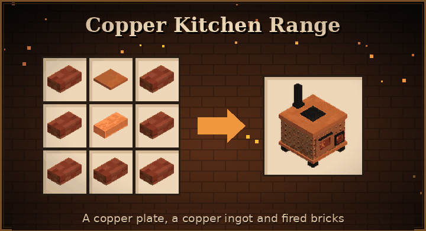
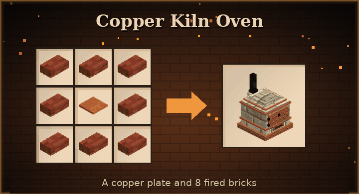
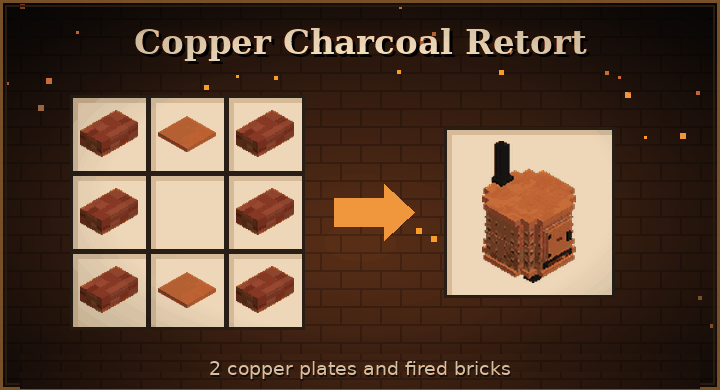
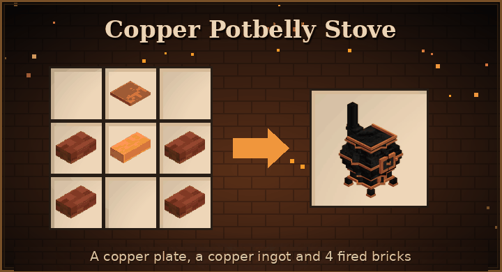
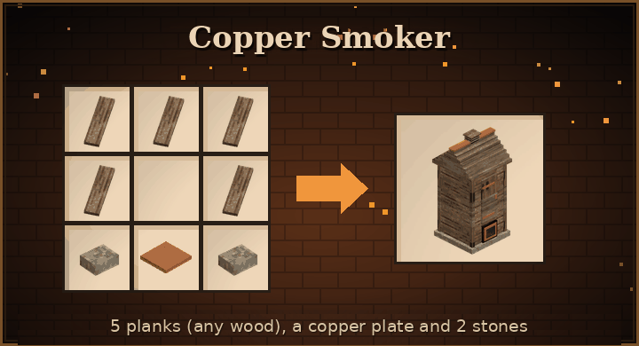
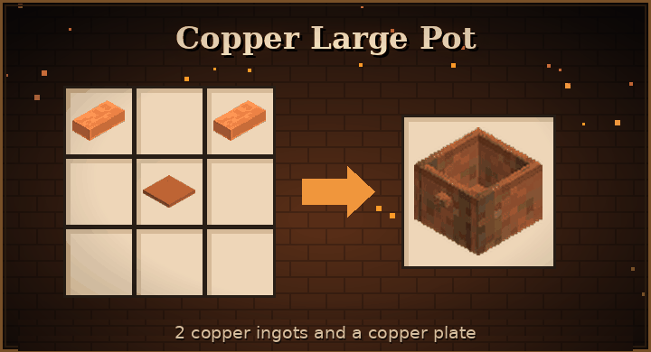

> **Still in testing. Use at your own risk, and please [report any problems](../../issues/new/choose) you run into.**

# 🔥 Forge and Feast

*Cook, fire, smelt and smoke indoors with five stoves in four tiers of iron-age kitchen gear: **Copper, Bronze, Iron and Steel**. Every tier is a solid step up from the base game without skipping the progression.*

## At a glance

|  | Copper | Bronze | Iron | Steel |
|---|---|---|---|---|
| **Range burner plates** | 1 | 2 | 3 | 4 |
| **Range oven slots** | – | 1 | 2 | 3 |
| **Range cooking speed** | ×1.1 | ×1.25 | ×1.4 | ×1.6 |
| **Kiln slots** | 2 | 3 | 4 | 5 |
| **Kiln firing time** | 12 h | 10 h | 8 h | 6 h |
| **Kiln max heat** | 1100°C | 1475°C | 1700°C | 1950°C |
| **Potbelly cooking speed** | ×1.0 | ×1.1 | ×1.25 | ×1.4 |
| **Potbelly fuel lasts** | ×1.5 | ×1.75 | ×2.0 | ×2.25 |
| **Potbelly max heat** | 450°C | 500°C | 550°C | 600°C |
| **Smoker hooks** | 4 | 6 | 8 | 10 |
| **Smoking time** | 24 h | 20 h | 16 h | 12 h |
| **Large Pot servings** | 8 | 10 | 12 | – |

Times are in-game hours. Kiln times are for a pot or mould; charcoal or coal roughly halves them.

---

### 🍲 Kitchen Range

*One fire heats several burner plates and an oven.*

- **1 to 4 burner plates.** Each takes a cooking pot, or a single item like a steak.
- **Built-in oven** from Bronze up. Bread comes out when it's done and never chars.
- **Food goes where it would in real life.** Baked and roasted food (bread, dough, pies, pemmican, roasted nuts) goes in the oven. Fried and boiled food (nuggets, sausages, dumplings, grain) goes on the burners. Raw meat, fish and vegetables can go in either.
- **Burners cook like a pan:** food moves to the output slot when it's done, before it can char.
- **Faster than a firepit,** from ×1.1 on Copper up to ×1.6 on Steel.
- **See what's cooking:** stew shows in the pot and meat sits on the plate.
- **Large Pots** cook bigger batches than the base game's 6-serving clay pot.

### 🏺 Kiln Oven

*Fires pottery and melts metal in one box.*

- **Fires moulds, pots and crucibles,** quicker than a pit kiln, on the in-game clock.
- **Crucibles go in the same slots as pottery,** so it fires and smelts at the same time. Pour the finished metal into a mould, just like at a firepit.
- **Higher tiers run hotter than their fuel.** Copper melts copper and every bronze. Going above about 1300°C needs coke.
- **Uses much less fuel per firing** than an open fire.

### ⚫ Charcoal Retort

*Wood in, charcoal out, with no pit to dig.*

- **Firewood and logs → charcoal,** at twice the yield of a base game charcoal pit.
- **Black and brown coal → coke,** at the base game coke oven rates, on every tier.
- **Runs on the in-game clock,** at about 1 in-game hour per charcoal.
- **Open the hatch** to see the wood stacked inside or the charcoal ready.
- **Very smoky,** so vent it well.

### 🫖 Potbelly Stove

*A small cast-iron stove for cabins and corners.*

- **Works like a firepit:** cooking pots, single items, serving meals from the pot, shift-adding fuel and lighting it all work the same. Other mods that cook on a firepit work on it too.
- **One cooking spot** on the hot plate on top, and the food or pot shows on it.
- **Fuel lasts longer** in its closed box: ×1.5 on Copper up to ×2.25 on Steel.
- **Keeps a room warm** like a firepit, with the fire's crackle. Its doors swing open while you use it.
- **Takes a stovepipe** on the flue at the back.

### 🥓 Smoker

*A two-block farm smokehouse that smokes and cures meat and fish.*

- **Hang raw meat or fish on the hooks** (4 to 10 by tier) and keep a small fire going. Smoking takes 24 in-game hours on Copper down to 12 on Steel, and pauses (doesn't reset) if the fire goes out.
- **Open the door** to see the meat hanging on its hooks. The firebox hatch opens too.
- **Wood gives full smoke;** charcoal and coal burn clean and smoke at a quarter of the speed.
- **Raw meat becomes cured meat** that keeps for about a year. Meat nuggets cure too, and meat keeps twice as long while it hangs.
- **Very smoky:** give it a chimney or a stovepipe on its roof, or put it outdoors.

### 💨 Smoke, Chimneys and Stovepipes

- **No chimney? The room fills with smoke.** In a sealed room, anyone inside starts choking after about 15 seconds. This also applies to the base game firepit and clay oven.
- **Chimney draft:** a Clay Brick Chimney above a stove, or joined to it by stovepipe, makes it work 25% faster.
- **Stovepipes join up on their own** to every stove, including the top of the Smoker, with bends, tees and crossings.
- **Runs stay level:** a sideways run tucks up under a roof or ceiling, lies on a floor, or sits in the middle, and the whole run, junctions and bends included, keeps the same height.
- **Through the roof:** a chimney just above a roof up to three blocks thick still counts, including the game's sloped roofing, ridges, thatch and shingles, so you don't need a hole in your roof.

### 🧩 Works with other mods

- **Expanded Foods:** meat nuggets cure in the Smoker, and the Range puts each food in the oven or on a burner as it should be.
- **Rustic Cookery:** the Smoker makes its smoked slabs, smoked meat and smoked fish. Braising, roux and eggs work on the Potbelly Stove with tongs, and the base game clay oven can be made again for Pot Roasts.
- **Feverstone Wilds:** the Smoker makes smoked bison leg, ribs and cockatrice tail, which count as cured meat in Expanded Foods recipes. They can also be roasted in the Range oven.
- **Primitive Survival:** crab and snake meat cure in the Smoker and chop into cured nuggets for Expanded Foods recipes. Its own smoker is replaced by the Forge and Feast Smoker. *(Not yet tested in game.)*
- **Carry On:** stoves can be picked up, if its settings allow it.

### ⚙️ Other Details

- Stoves **face you** when placed and can be turned with the **wrench**.
- Doors **open** when you use a stove and **close** when you leave.
- The base game **clay oven can't be crafted** while this mod is installed (unless Rustic Cookery is), because the Kitchen Range replaces it. The firepit is unchanged.

### 🔨 Crafting

Start with Copper, then upgrade each stove by putting a plate of the next metal on each side of it.

<b>Kitchen Range</b> 

<b>Kiln Oven</b> 

<b>Charcoal Retort</b> 

<b>Potbelly Stove</b> 

<b>Smoker</b> 

<b>Large Pots and Stovepipes</b> 

- **Copper tier:** fired bricks plus copper. The Kiln Oven takes 1 copper plate, the Retort 2, the Range and Potbelly Stove 1 plate and 1 ingot. The Smoker takes 5 planks, 2 stones and 1 copper plate.
- **Higher tiers:** 2 plates of the new metal, one on each side of the previous tier.
- **Large Pots:** 2 ingots and 1 plate of the same metal. The Bronze pot takes any bronze.
- **Stovepipes:** 2 metal plates of any kind make 8 pipes.

---

📦 **Install:** needed on **both the server and every player's game**. Made for Vintage Story 1.22.

## Download

- ModDB (1-click install): https://mods.vintagestory.at/forgeandfeast
- Or take a zip from the [Releases](../../releases) page and put it, unzipped, in your Mods folder.

## Report a problem

Open an issue using the bug report form: [New issue](../../issues/new/choose). Please include your game version, the mod version and your log.

**Where to find your log**

The logs are in the Vintage Story data folder, in a folder called `Logs`:

| System | Data folder |
|---|---|
| Windows | `%appdata%\VintagestoryData` (paste that into the File Explorer address bar) |
| Linux | `~/.config/VintagestoryData` |
| Mac | `~/Library/Application Support/VintagestoryData` |

- **Playing on a server:** send `client-main.log` from your own game. If you run the server, also send `server-main.log` from the server's data folder.
- **Singleplayer:** `client-main.log` and `server-main.log` are both in the data folder above.
- Attach the file to the issue (drag it into the box), or paste just the lines with errors. Reproduce the problem first, then grab the log straight afterwards, so the error is near the end.

## Changelog

Release notes are on each release. The full history is in `CHANGELOG.txt`, and each commit is one released version.
